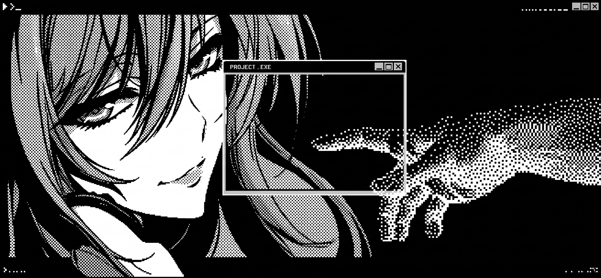
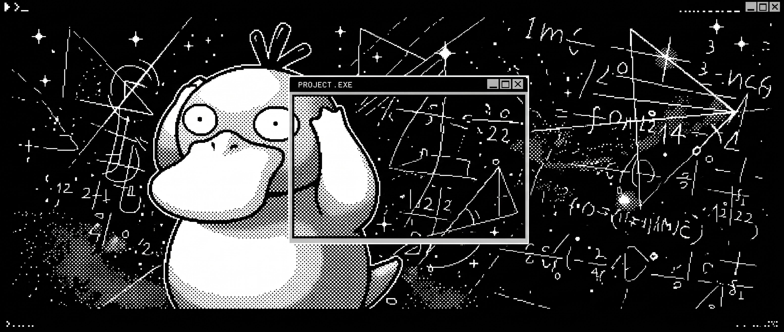

  

# Me chamo Caetano!

### Software Engineering Student | Developer in Progress

Estudando programação, construindo projetos e evoluindo um commit por vez.

---

## Sobre mim

- Estudando Engenharia de Software e programação.
- Desenvolvendo projetos para praticar lógica e desenvolvimento.
- Aprendendo a construir soluções reais com código.

## Tecnologias

### GitHub Stats

  

---

### Activity Graph

  

  

